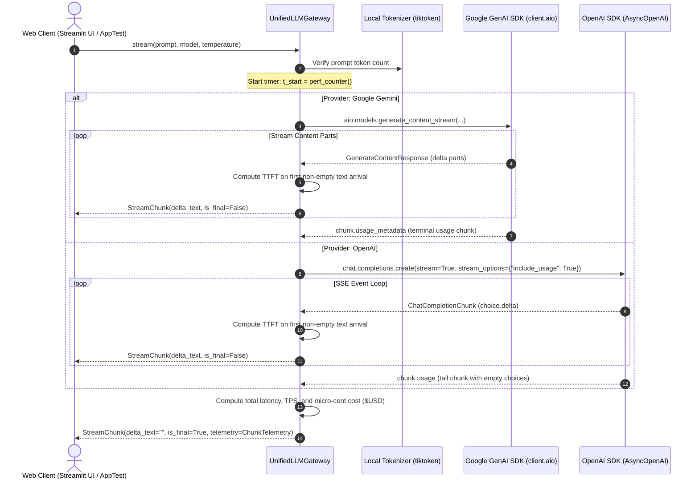

# Multi-Provider LLM Gateway: Google Gemini & OpenAI

An asynchronous, unified LLM gateway and real-time telemetry engine built with **Python 3.11**, **`uv`**, **Pydantic v2**, and **Streamlit**.

This platform decouples upstream application workflows from foundation model providers (**Google Gemini** and **OpenAI**), normalizes streaming chunk formats into a single typing contract, prevents event-loop blocking, and calculates token throughput and micro-cent financial costs ($USD$) in real time.

---

## Table of Contents

1. [Project Overview & Architecture Diagram](#1-project-overview--architecture-diagram)
2. [Environment & Prerequisites](#2-environment--prerequisites)
3. [Configuration & Security](#3-configuration--security)
4. [Execution Instructions](#4-execution-instructions)
5. [Pricing Matrix Documentation](#5-pricing-matrix-documentation)
6. [Audit & Verification Summary](#6-audit--verification-summary)
7. [Project Layout](#7-project-layout)
8. [Automated QA & UI Test Suite](#8-automated-qa--ui-test-suite)
9. [Video Demonstration & Submission Guide](#9-video-demonstration--submission-guide)

---

## 1. Project Overview & Architecture Diagram

Modern applied AI architectures suffer when tightly coupled to single foundation model SDKs. Such coupling introduces vendor lock-in, unmanaged latency variance, and financial exposure. 

This project implements `UnifiedLLMGateway`, an asynchronous abstraction layer that exposes a normalized streaming interface (`AsyncGenerator[StreamChunk, None]`) across Google Gemini and OpenAI. Upstream consumers receive delta tokens uniformly, while the engine captures token counts from upstream metadata and calculates Time-to-First-Token (TTFT), tokens-per-second (TPS), and micro-cent financial execution cost ($USD$).

### Pipeline Architecture



---

## 2. Environment & Prerequisites

* **Python Runtime:** Python 3.11 or higher (strictly enforced)
* **Package Management:** Choose between modern tooling with **`uv`** (recommended) or **`poetry`**.

### Option A: Setup with `uv` (Recommended)

`uv` provides deterministic, high-performance dependency resolution.

```bash
# Clone the repository
git clone https://github.com/[your-username]/multi-provider-llm-gateway.git
cd multi-provider-llm-gateway

# Pin Python 3.11
uv python pin 3.11

# Install runtime and testing dependencies into the isolated virtual environment
uv sync
```

To add packages or initialize from scratch:
```bash
uv init multi-provider-llm-gateway
cd multi-provider-llm-gateway
uv python pin 3.11
uv add google-genai openai pydantic tiktoken streamlit python-dotenv pytest pytest-asyncio
```

### Option B: Setup with `poetry`

If using Poetry for dependency management:

```bash
# Initialize and tell Poetry to use Python 3.11
poetry env use 3.11

# Install dependencies from pyproject.toml
poetry install
```

---

## 3. Configuration & Security

### 1. Environment Variable Setup

Copy the template configuration file to `.env`:
```bash
cp .env.example .env
```

Populate your `.env` file with your respective API keys:
```env
GEMINI_API_KEY=AIzaSy...
OPENAI_API_KEY=sk-proj-...
```

### 2. Security Engineering Guardrails

* **Secret Isolation:** `.env` is explicitly declared in `.gitignore` to prevent committing live API tokens to version control.
* **Automated Redaction Engine:** Custom domain exceptions inherit from `GatewayBaseException`. Error messages pass through regex sanitization to strip API key substrings (matching `sk-[a-zA-Z0-9_-]{8,}` or `AIza[0-9A-Za-z-_]{35}`) and replace them with `[REDACTED_API_KEY]` before rendering to terminal logs or browser interfaces.
* **Connection Pooling:** SDK client instances (`genai.Client`, `AsyncOpenAI`) are instantiated as cached properties on `UnifiedLLMGateway` rather than recreated per request. This prevents TCP socket exhaustion and avoids TLS handshake overhead under concurrent traffic.

---

## 4. Execution Instructions

### 1. Launch the Interactive Web Interface

Start the local Streamlit application:

* **Using `uv`:**
  ```bash
  uv run streamlit run src/app.py
  ```
* **Using `poetry`:**
  ```bash
  poetry run streamlit run src/app.py
  ```

Once running, access the user interface at: `http://localhost:8501`.

### 2. Execute the Automated Test Harness

Run all async integration, unit, and security tests:

* **Using `uv`:**
  ```bash
  uv run pytest -v
  ```
* **Using `poetry`:**
  ```bash
  poetry run pytest -v
  ```

To run a specific test suite:
```bash
# Run security and redaction tests
uv run pytest tests/test_security.py -v

# Run gateway and telemetry verification
uv run pytest tests/test_gateway.py -v
```

### 3. Containerized Execution (Docker)

To run the application inside an isolated container:
```bash
# Build and run with docker compose
docker compose up --build

# Run in detached mode
docker compose up -d
```

---

## 5. Pricing Matrix Documentation

Telemetry calculates the financial execution cost down to micro-cents ($USD$, 6 decimal places).

$$\text{Cost} = \left(\frac{\text{Prompt Tokens}}{1,000,000} \times \text{Input Rate}\right) + \left(\frac{\text{Completion Tokens}}{1,000,000} \times \text{Output Rate}\right)$$

### Official Pricing Matrix (per 1,000,000 Tokens)

| Provider | Model Identifier | Input Rate ($USD$ / 1M Tokens) | Output Rate ($USD$ / 1M Tokens) | Telemetry Resolution |
| :--- | :--- | :--- | :--- | :--- |
| **Google Gemini** | `gemini-2.5-flash` | $\$0.0750$ | $\$0.3000$ | Micro-cents ($6$ decimals) |
| **Google Gemini** | `gemini-1.5-flash` | $\$0.0750$ | $\$0.3000$ | Micro-cents ($6$ decimals) |
| **Google Gemini** | `gemini-1.5-pro` | $\$1.2500$ | $\$5.0000$ | Micro-cents ($6$ decimals) |
| **OpenAI** | `gpt-4o-mini` | $\$0.1500$ | $\$0.6000$ | Micro-cents ($6$ decimals) |
| **OpenAI** | `gpt-4o` | $\$2.5000$ | $\$10.0000$ | Micro-cents ($6$ decimals) |

---

## 6. Audit & Verification Summary

During the human-in-the-loop review of the initial AI pair-programmer code draft, five concrete bugs, anti-patterns, and security flaws were identified and resolved in `ai_prompt_log.md`:

### 1. Gemini Event-Loop Blocking (Sync vs. Async Call)
* **Initial Code:** The draft called `client.models.generate_content_stream(...)` synchronously inside an `async def stream(...)` generator.
* **Issue:** Google's synchronous SDK call blocks Python's asynchronous event loop, freezing user interfaces and downstream asynchronous pipelines under load.
* **Refactored Code:** Migrated directly to Google's asynchronous engine: `await client.aio.models.generate_content_stream(...)`.

### 2. Gemini `chunk.text` Accessor Crash on Metadata Chunks
* **Initial Code:** The draft accessed `chunk.text` unconditionally on every yielded response.
* **Issue:** When Gemini yields the terminal chunk containing `usage_metadata` or a safety finish reason without text parts, reading `chunk.text` throws an unhandled `ValueError: Value not found for property text`.
* **Refactored Code:** Inspected `chunk.candidates[0].content.parts` safely with fallback guards, parsing `chunk.usage_metadata` independently.

### 3. OpenAI Tail Chunk Crash (`choices[0].delta.content is None`)
* **Initial Code:** The AI extracted tokens with `chunk.choices[0].delta.content`.
* **Issue:** When `stream_options={"include_usage": True}` is enabled, OpenAI emits a trailing chunk where `choices` is an empty list (`[]`) or `content` is `None` to pass token telemetry. The AI draft crashed with `IndexError` or `TypeError`.
* **Refactored Code:** Added length validation `if chunk.choices and len(chunk.choices) > 0:` and read `chunk.usage` directly from the tail chunk.

### 4. Client Instantiation Anti-Pattern (Connection Pool Destruction)
* **Initial Code:** The AI initialized `client = genai.Client(...)` and `client = AsyncOpenAI(...)` inside the body of the `stream()` method on each invocation.
* **Issue:** Creating new client instances per stream destroys HTTP connection pooling, repeatedly performs TLS handshakes, and leads to socket exhaustion under high concurrency.
* **Refactored Code:** Centralized persistent clients as properties on the `UnifiedLLMGateway` instance.

### 5. Time-to-First-Token (TTFT) Timing Drift
* **Initial Code:** The initial draft captured `first_token_time = time.perf_counter()` immediately before the streaming loop began.
* **Issue:** TTFT measured Python object setup time instead of true network latency to the first emitted text token.
* **Refactored Code:** Set `first_token_time = time.perf_counter()` strictly when the first chunk with `len(delta_text) > 0` arrives.

---

## 7. Project Layout

```text
multi-provider-llm-gateway/
├── .env.example              # Documented environment template
├── .gitignore                # Protects secrets, caches, and virtualenvs
├── pyproject.toml            # uv/poetry metadata and pinned dependencies
├── Dockerfile                # Production container specification
├── docker-compose.yml        # Multi-container orchestration specification
├── README.md                 # Complete system documentation
├── ai_prompt_log.md          # Human-in-the-loop AI generation audit log
├── src/
│   ├── __init__.py
│   ├── schemas.py            # Typed Pydantic models & domain exceptions
│   ├── pricing.py            # Published rates & micro-cent calculation engine
│   ├── gateway.py            # Connection-pooled async streaming gateway
│   └── app.py                # Interactive Streamlit interface with live telemetry
└── tests/
    ├── __init__.py
    ├── test_gateway.py       # Streaming, token counting, & telemetry sanity tests
    ├── test_security.py      # Credential redaction & typed exception tests
    └── test_ui.py            # Streamlit AppTest automated UI interaction tests
```

---

## 8. Automated QA & UI Test Suite

The test suite covers streaming normalization, token validation against local tokenizers, telemetry sanity, secret redaction, and UI interactions.

### Automated UI Tests (`tests/test_ui.py`)

Using Streamlit's native `AppTest` framework, UI interactions are tested headlessly without launching a browser:

```python
"""Automated UI tests for the Streamlit gateway interface."""

from unittest.mock import patch
from streamlit.testing.v1 import AppTest
from src.schemas import StreamChunk, ChunkTelemetry


def test_ui_initial_render():
    """Verify default UI controls render with expected initial state."""
    at = AppTest.from_file("src/app.py").run()
    assert not at.exception
    assert at.title[0].value == "⚡ Multi-Provider LLM Gateway"
    # Selectbox defaults
    assert at.sidebar.selectbox[0].value == "Google Gemini"
    assert at.sidebar.selectbox[1].value == "gemini-2.5-flash"


def test_ui_empty_prompt_warning():
    """Verify empty prompt submissions trigger warning feedback."""
    at = AppTest.from_file("src/app.py").run()
    # Click generate without prompt
    at.button[0].click().run()
    assert len(at.warning) > 0
    assert at.warning[0].value == "Please enter a valid prompt."


def test_ui_streaming_telemetry_display():
    """Verify UI updates metrics and markdown output during generation."""
    async def mock_stream(prompt, model, temp):
        yield StreamChunk(delta_text="Hello", provider="gemini", model=model, is_final=False)
        yield StreamChunk(
            delta_text="",
            provider="gemini",
            model=model,
            is_final=True,
            telemetry=ChunkTelemetry(
                prompt_tokens=5,
                completion_tokens=1,
                total_tokens=6,
                time_to_first_token_ms=120.5,
                total_latency_seconds=0.35,
                tokens_per_second=2.86,
                total_cost_usd=0.000001,
            ),
        )

    with patch("src.gateway.UnifiedLLMGateway.stream", side_effect=mock_stream):
        at = AppTest.from_file("src/app.py").run()
        at.text_area[0].input("Explain latency").run()
        at.button[0].click().run()

        assert not at.exception
        # Ensure streamed output updated markdown
        assert "Hello" in at.markdown[1].value
```

---
