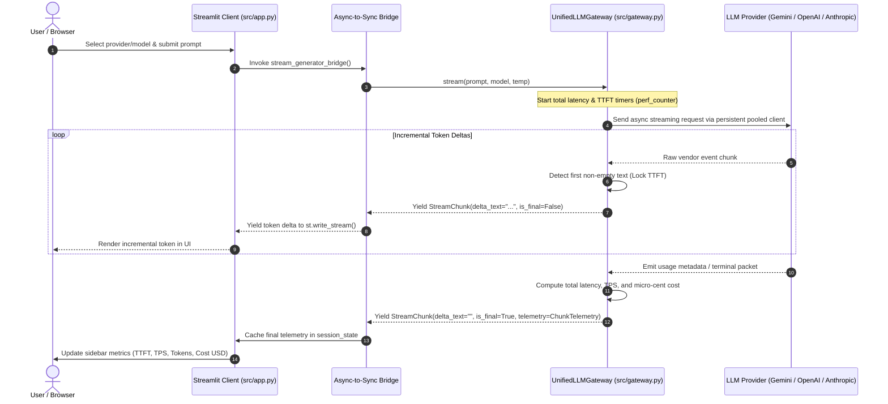

# ⚡ Multi-Provider LLM Gateway

A resilient, asynchronous streaming abstraction layer and real-time telemetry engine decoupling upstream application logic from foundational LLM providers (Google Gemini, OpenAI, and Anthropic).

---

## 🌐 Live Demo & Deliverables

* **Interactive Web Application:** [https://bahaeldin.streamlit.app/](https://bahaeldin.streamlit.app/)
* **Architecture Walkthrough Video:** [Walkthrough Video Link](https://loom.com/your-video-link) *(Insert your recorded walkthrough link here)*

---

## 1. Project Overview & Architecture Diagram

Production AI software demands a unified abstraction layer that decouples upstream application logic from underlying provider SDKs. Relying on a single foundation model provider introduces vendor lock-in, unmanaged latency variance, and financial exposure.

This gateway provides a unified asynchronous client interface (`UnifiedLLMGateway`) that:

* **Normalizes Streams:** Ingests disparate vendor chunk deltas and token usage events into immutable, strictly validated Pydantic v2 data models (`StreamChunk`).
* **Prevents Latency Penalties:** Eliminates per-request TCP/TLS handshake overhead by maintaining persistent, connection-pooled HTTP client sessions across runtime interactions.
* **Profiles Real-Time Telemetry:** Calculates user-perceived Time-to-First-Token (TTFT), token generation throughput (Tokens/sec), and execution cost down to micro-cents ($USD) with zero floating-point drift.
* **Guarantees Secret Scrubbing:** Sanitizes sensitive credentials and API key signatures from exception tracebacks, terminal output, and consumer logs.

### Streaming Pipeline Architecture

